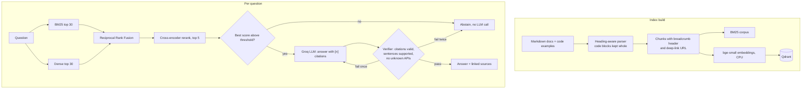

# DocSight

**Citation-grounded Q&A over technical documentation.** Ask a question about the FastAPI docs and get an answer where every claim links to the exact section it came from. Answers that cite the wrong passage or use an API that doesn't exist in the docs are caught before they reach you, and questions the docs don't cover get "I couldn't find this" instead of a made-up answer.

Works on any folder of markdown docs; the FastAPI docs (150 pages, ~1,200 chunks) are the default corpus.

<!-- Add a 30-60 s demo GIF here once deployed -->

## Results

Measured on `eval/questions.jsonl`: 42 real developer questions with gold pages, plus 8 the docs don't answer.

**Retrieval** (`make eval-retrieval`): fill in after running with the real models.

| Config | Hit@1 | Hit@5 | MRR@10 | p95 ms |
| --- | --- | --- | --- | --- |
| BM25 only | | | | |
| Dense only (bge-small) | | | | |
| Hybrid (RRF) | | | | |
| Hybrid + rerank | | | | |

**Answers** (`make eval-answers`, needs a Groq key): accuracy (judge, validated against hand labels), false-abstain rate, correct-abstain rate on unanswerable questions, verifier pass rate, p95 latency, tokens per question.

## How it works



## Design decisions

- **Hybrid search.** BM25 catches exact identifiers (`BackgroundTasks`, `root_path`, error strings) that embeddings blur; dense search catches paraphrases ("run code after the response is sent"). Fused with RRF because it uses ranks only, so no score calibration between the two.
- **Heading-aware chunks.** Docs authors already split content into one idea per heading. Each chunk is prefixed with its heading path, which helps both retrievers, and code blocks are never split.
- **Cross-encoder reranking** on the top 30 only: accurate but expensive, so it runs where it pays off.
- **Deterministic verification before the user sees anything.** No LLM call needed: checks citation numbers, citation coverage, lexical support, and that every API name in the answer exists in the retrieved passages. One retry with the verifier's feedback, then abstain.
- **Abstain early.** If the reranker finds nothing relevant, we skip the LLM call entirely.
- **Groq cache.** Responses are cached by (model, messages, params), so eval reruns are free and deterministic under free-tier rate limits.
- **Judge from a different model family** than the answer model, validated against hand labels (`eval/judge_agreement.py`).

## Quickstart

```bash
cp .env.example .env          # add GROQ_API_KEY
make install                  # CPU-only torch + requirements
make data                     # fetch FastAPI docs (~10 s)
make index                    # parse, chunk, embed (~1-2 min on a laptop)
make ui                       # Streamlit at :8501
make api                      # FastAPI at :8000/docs
make test
```

Docker: `docker compose up --build` (API on :8000, UI on :8501).

**Deploy free on Hugging Face Spaces:** create a Space with the Docker SDK, push this repo, and add `GROQ_API_KEY` as a secret. Spaces reads its config from YAML at the top of README.md: add `sdk: docker` and `app_port: 7860` there in the Space copy. The image builds the index at build time and serves Streamlit on port 7860.

## Project layout

```
docsight/
  ingest/       markdown parser, chunker
  retrieval/    BM25, Qdrant dense index, RRF, reranker, hybrid retriever
  generation/   prompts, verifier
  llm.py        Groq client with retry + cache, FakeLLM for tests
  pipeline.py   retrieve -> abstain? -> generate -> verify -> retry
  api.py        FastAPI service
  tracing.py    optional Langfuse spans
app.py          Streamlit UI
eval/           question set, retrieval ablation, answer eval, judge agreement
scripts/        fetch docs, build index
```

See [DEVELOPMENT_TIMELINE.md](DEVELOPMENT_TIMELINE.md) for the order the project was built in (dates are estimates).

## Limitations

- The eval set is 50 questions written by one person; numbers have wide error bars.
- The support check is lexical. It catches unsupported sentences that use different words from the source, but not a sentence that reuses the source's words with the wrong meaning; the LLM judge covers that in eval.
- English docs only; one docs site per index.
